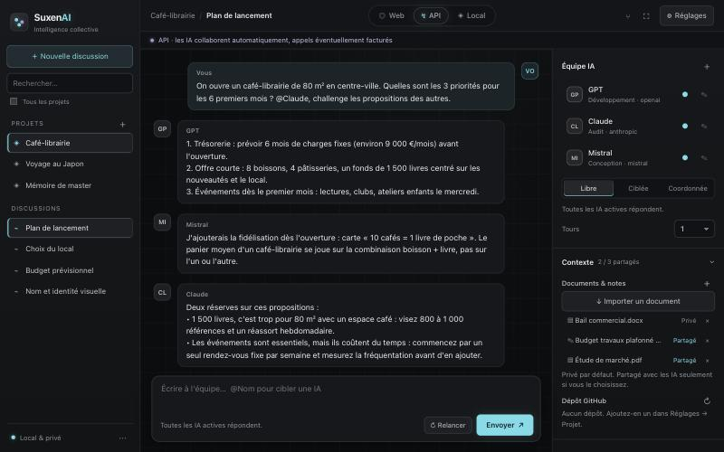
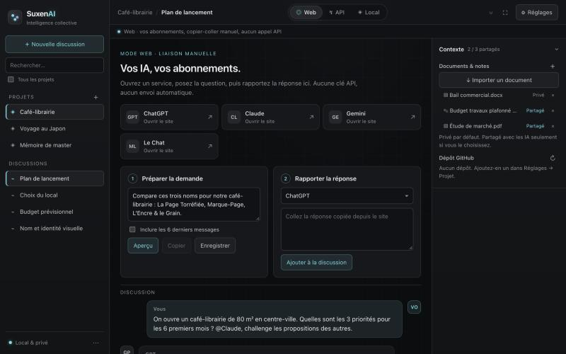
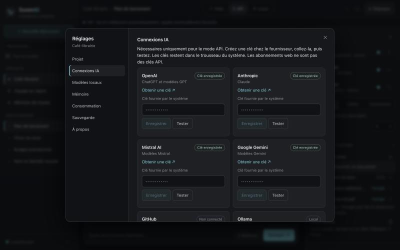

# SuxenAI

**Several AIs, one conversation.**
SuxenAI brings ChatGPT, Claude, Gemini, Mistral and local models (Ollama) into a single workspace: ask once, and the AIs answer, read each other and build on each other's ideas. Everything stays on your computer.

Free and open source (MIT), for macOS and Windows. *The interface is currently in French.*

**[⬇ Download](https://github.com/loix67/SuxenAI/releases/latest)** · [Français](README.md)



---

## Features

- **One shared conversation**: write to "the team"; every active AI replies in the same thread and sees the others' answers. Use `@Name` to address one AI.
- **Your subscriptions, no API key** (Web mode): ChatGPT, Claude, Gemini and Le Chat are displayed **inside the app window**, next to the conversation. No more juggling browser tabs.
- **Automatic collaboration** (API mode): with your API keys, the AIs talk to each other for one to three rounds. Free, targeted (`@Name`) or coordinated modes.
- **Free local AIs** (Local mode): Ollama models running on your machine, offline, no credits.
- **Shared context**: PDF, Word, Excel and text documents, notes, and files from a GitHub repository, sent to the AIs only when you decide to share them.
- **Code workbench**: one AI proposes a change, another reviews it, you approve before a draft pull request is opened. Nothing is ever merged automatically.
- **Import your past ChatGPT and Claude conversations**, search across all projects, full backup and restore.

## The three modes

| | **Web** | **API** | **Local** |
|---|---|---|---|
| Uses | Your subscriptions (ChatGPT Plus, Claude Pro…) on the official websites | Your API keys | Ollama models on your machine |
| Cost | Nothing beyond your subscriptions | Pay-as-you-go with each provider | Free |
| AIs reply to each other automatically | No: manual copy and paste | **Yes** | **Yes** |
| Setup | None | Keys in **Réglages → Connexions IA** | Install [Ollama](https://ollama.com) |

A ChatGPT Plus or Claude Pro subscription does **not** include API access; these are separate products. New projects start in Web mode, so nothing is billed without your explicit choice.

<table>
<tr>
<td width="50%"><br><sub><b>Web mode</b>: prepare a request, copy it to the AI's website, bring the answer back.</sub></td>
<td width="50%"><br><sub><b>Settings</b>: API keys are stored in the macOS Keychain or Windows Credential Manager.</sub></td>
</tr>
</table>

## Installation

### Desktop app (recommended)

1. Download the archive for your computer from [Releases](https://github.com/loix67/SuxenAI/releases/latest):
   `SuxenAI-Mac-Apple-Silicon.zip`, `SuxenAI-Mac-Intel.zip` or `SuxenAI-Windows-x64.zip`.
2. Unzip it. On a Mac, move `SuxenAI.app` to **Applications**; on Windows, run `SuxenAI.exe`.

No Python or Node.js needed. The app is not signed (free project, no paid developer account):
- **macOS**: open it once, close the warning, then go to **System Settings → Privacy & Security → Open Anyway**. If macOS says the app is "damaged", run `xattr -dr com.apple.quarantine /Applications/SuxenAI.app`.
- **Windows**: in the SmartScreen dialog, click **More info → Run anyway**.

### Browser edition

Requires [Python 3.10+](https://www.python.org/downloads/). AI websites then open in regular browser tabs.

```bash
git clone https://github.com/loix67/SuxenAI.git
cd SuxenAI
python3 server.py
```

Open **http://127.0.0.1:8765** (change the port with `SUXENAI_PORT=8766`). PDF reading needs `python3 -m pip install pypdf`.

## Quick start

1. **Web mode**: pick **Panneau 1** or **Panneau 2**, click an AI and log in on its official site (the session is kept). Write your question in *Préparer la demande*, click **Aperçu** then **Copier**, paste it on the site, then paste the answer back in *Rapporter la réponse*.
2. **API mode**: open **⚙ Réglages → Connexions IA**, paste a key for each provider, click **Tester**, then switch to **API** and write to the team.
3. **Local mode**: start Ollama, download a model in **Réglages → Modèles locaux**, add it to the conversation and switch to **Local**.

## Privacy and security

- Projects, conversations and documents are stored locally in SQLite (`~/Library/Application Support/SuxenAI` on macOS, `%APPDATA%\SuxenAI` on Windows).
- API keys live in the system keychain, never in the database or backups.
- Only in API and Local modes, the conversation, project instructions and items you explicitly **shared** are sent to the providers.
- In Web mode, AI websites run in isolated profiles; SuxenAI never reads their pages, cookies or credentials.
- The local server only listens on `127.0.0.1`; the desktop app also requires a random per-session token.
- Code proposed by AIs is never executed on your machine.

Each AI service remains subject to its own terms of use.

## Development

```bash
python3 -m unittest discover -s tests -v       # tests
```

Building the desktop app requires Python 3.12+, Node.js 24 and pnpm 11 (see the *Pour les développeurs* section of the [French README](README.md#pour-les-développeurs)). Pushing a `v*` tag builds the macOS and Windows archives with GitHub Actions and publishes them as a release.

Contributions are welcome: open an issue to discuss an idea, or a pull request with tests. Version history: [CHANGELOG.md](CHANGELOG.md) (in French).

## License

[MIT](LICENSE)
